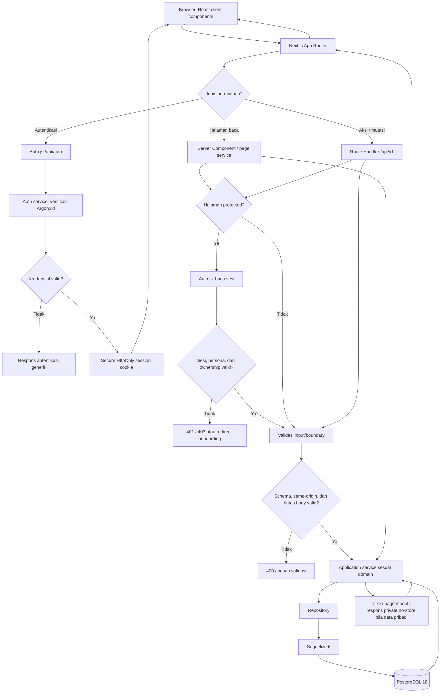
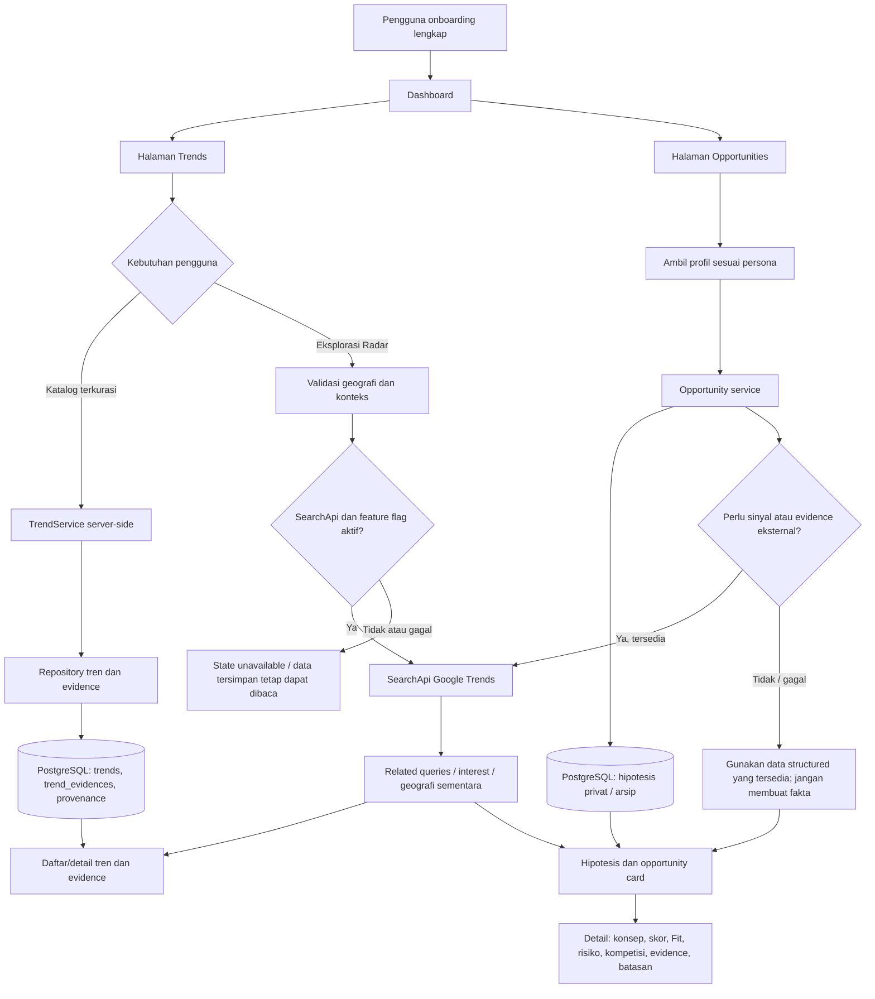
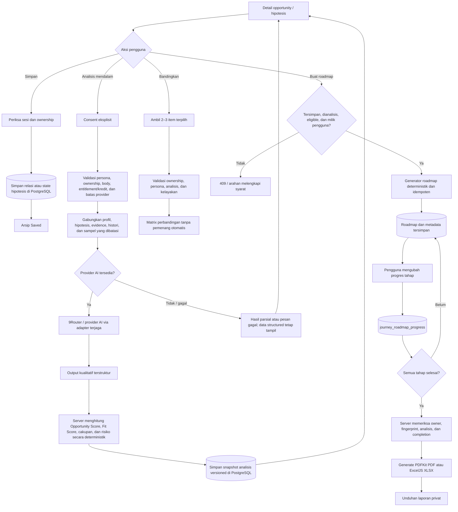
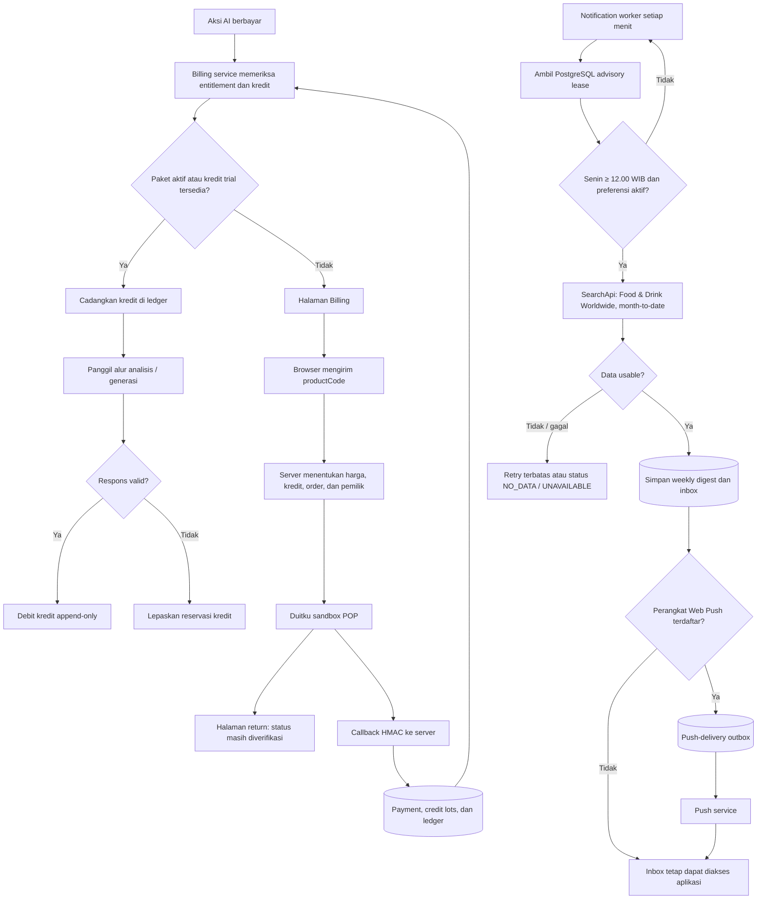

# Alur Kerja Aplikasi — VENTUREX AI

Dokumen ini menjelaskan bagaimana komponen aplikasi bekerja dari permintaan pengguna hingga data/presentasi dikembalikan. Cakupan utamanya adalah aplikasi pengguna; alur administrasi tidak ditampilkan.

## 1. Siklus permintaan aplikasi

## 2. Kerja fitur Discover: katalog tren dan Opportunity Finder

## 3. Kerja analisis, scoring, simpan, roadmap, dan laporan

## 4. Billing, notifikasi, dan proses latar

## Batas penting

- Browser tidak menerima secret provider, harga authoritative, ownership decision, atau perhitungan core score.
- Katalog tren terkurasi memakai layanan internal dan PostgreSQL; hasil Radar dari provider bersifat sementara dan tidak otomatis menjadi katalog.
- Provider eksternal bersifat opsional dan gagal secara graceful. Search interest bukan bukti penjualan, pendapatan, atau kepastian permintaan.
- Callback pembayaran adalah satu-satunya jalur yang menyelesaikan transaksi; halaman return tidak dapat mengubah status finansial.
- Notifikasi Web Push best effort; inbox aplikasi adalah sumber state notifikasi pengguna.
