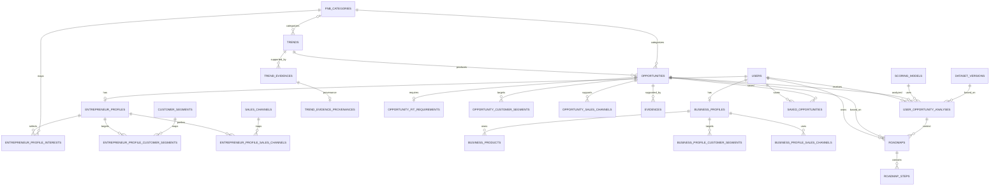

# DATABASE DESIGN

21 October recovery refinement: optional analysis.planningContext.timeCommitment preserves historical capacity; roadmap generatorVersion also accepts personalized-v3 and personalized-v4 (22 October text correction). Compare recovers from unavailable owner-scoped choices with a neutral notice. See Entrepreneur MVP Completion.md.
21 October refinement: optional hypothesis.analysis.referenceLabels retains category/channel display names for new snapshots; optional startupRoadmap.generatorVersion identifies personalized-v2. Legacy JSON remains readable; no migration or historic rewrite. See Entrepreneur MVP Completion.md.

Entrepreneur MVP completion (21 October 2026): optional validated hypothesis.startupRoadmap stores private-startup-v1, server createdAt, analysis sourceFingerprint and six bounded steps. Creation locks the compound owner/id/ENTREPRENEUR row, requires is_saved and valid numeric analyzed scores, returns an existing roadmap idempotently, and updates only additive roadmap metadata. Archived hypothesis.analysis is unchanged. Existing JSONB supports this extension without schema migration. No private hypothesis is promoted into global opportunities/roadmaps foreign keys. Archive queries page 12 rows plus lookahead by created_at DESC,id ASC; roadmap library filters the JSONB version. Legacy rows without metadata remain valid.

Entrepreneur Analyze v2 amendment (21 October 2026): no table/column migration. Persist a bounded versioned decision snapshot at `user_generated_opportunities.hypothesis.analysis` within existing JSONB: derived requirements/reference IDs, score factors/provenance, summary trend statistics, bounded listing examples, risks, warnings, model, generated time and input HMAC. Read/update only by compound `{ id, userId, userType: ENTREPRENEUR }`; saved state and original hypothesis fields remain intact. No raw profile, prompt, full trend history or public catalog score snapshot is persisted. Invalid/unrecognized analysis snapshots fall back to reading the base hypothesis. See `Entrepreneur Deep Analysis.md`.

Dashboard exploration amendment (21 October 2026): no schema or migration change. Previews read existing `user_generated_opportunities` rows using authenticated `user_id`; saved previews use the existing saved-only repository filter independently of the latest unsaved rows. Saved-roadmap availability uses the existing user-scoped roadmap repository. A single last related-query result per account may be retained in browser localStorage for preview only, including query metrics and retrieval/filter metadata; it contains no profile notes, financial profile values, credentials, or signed generation-source tokens. This browser snapshot is not stored in PostgreSQL or used as authoritative generation evidence.
## VENTUREX AI — Future Trend Intelligence & Business Growth Navigator

**Dokumen:** Database Design
**Versi:** 1.0
**Status:** Database Baseline untuk MVP Hackathon
**Referensi Produk:** `VENTUREX_AI_PRD.md`
**Referensi Fungsional:** `VENTUREX_AI_FSD.md`
**Referensi Teknologi:** `Tech Stack Requirement.md`
**DBMS:** PostgreSQL 18.x
**ORM:** Sequelize v6
**Primary Key:** UUID
**Naming:** `snake_case` di database, `camelCase` di TypeScript

---

# 1. Tujuan

Dokumen ini menerjemahkan kebutuhan data pada PRD dan FSD VENTUREX AI menjadi rancangan database relasional yang dapat langsung dijadikan acuan untuk:

- ERD;
- Sequelize Model;
- Migration;
- Repository Layer;
- Integration Test;
- Seed Data;
- Deployment PostgreSQL.

Database harus mendukung dua jalur pengguna:

**Calon Pengusaha:**
`Discover → Analyze → Start`

**UMKM Existing:**
`Discover → Analyze → Grow`

Database tidak boleh menambahkan fitur bisnis baru di luar PRD/FSD.

### Trend MVP contract

Trend Intelligence MVP uses an internal persistent curated catalog. Its core persistence is `trends` and `trend_evidences`, matching `db/migrations/008-create-trends.ts`. Migration `017-create-trend-evidence-provenances.ts` adds optional source metadata linked one-to-zero-or-one with a Trend Evidence row; it neither backfills historical records nor changes the user-facing Trend path. `dataset_versions` and the shared `evidences` table below are not part of this Trend path. The shared `evidences` design remains for planned Opportunity evidence and possible future reuse; do not treat its Trend relationship as the current Trend evidence store. The catalog requires real, human-reviewed evidence and must not be populated with fabricated Trend records.

---

# 2. Requirement Basis

Core logical entities dari PRD/FSD:

1. User
2. EntrepreneurProfile
3. BusinessProfile
4. Trend
5. Opportunity
6. UserOpportunityAnalysis
7. Evidence
8. SavedOpportunity
9. Roadmap
10. RoadmapStep

Relationship utama:

```text
User 1 — 0..1 EntrepreneurProfile
User 1 — 0..1 BusinessProfile

Trend 1 — * Opportunity

User * — * Opportunity
through UserOpportunityAnalysis

Trend 1 — * TrendEvidence
Opportunity 1 — * Evidence (planned shared design)

User * — * Opportunity
through SavedOpportunity

User 1 — * Roadmap
Opportunity 1 — * Roadmap
Roadmap 1 — * RoadmapStep
```

Database Design menambahkan beberapa support tables untuk normalisasi dan kebutuhan scoring, tetapi tidak menambah fitur bisnis baru.

---

# 3. Design Principles

## 3.1 Relational First

Gunakan relational table untuk data inti.

JSONB hanya untuk:

- metadata fleksibel;
- snapshot AI;
- score breakdown;
- external-provider metadata.

Jangan menyimpan core entity sebagai satu blob JSON.

## 3.2 Normalization

Target desain adalah 3NF secara praktis.

Multi-select seperti:

- interest;
- customer segment;
- sales channel;

disimpan melalui junction table.

## 3.3 Deterministic Scoring

Opportunity Score dan Fit Score harus dapat ditelusuri.

Setiap analysis menyimpan:

- score;
- breakdown;
- risk;
- profile version;
- dataset version;
- scoring model version;
- generated timestamp.

## 3.4 UTC

Semua timestamp:

```text
TIMESTAMPTZ
```

dan diperlakukan dalam UTC.

## 3.5 Money

Nominal Rupiah:

```text
BIGINT
```

Bukan `FLOAT`.

## 3.6 Scores

Score 0–100:

```text
NUMERIC(5,2)
```

---

# 4. Naming Convention

Database:

```text
snake_case
```

Contoh:

```text
user_opportunity_analyses
saved_opportunities
```

TypeScript:

```text
camelCase
```

Sequelize:

```typescript
underscored: true
timestamps: true
```

---

# 5. Table Inventory

## Core Domain Tables

| Table | Fungsi |
|---|---|
| `users` | Akun, tipe user, onboarding |
| `entrepreneur_profiles` | Profil calon pengusaha |
| `business_profiles` | Profil UMKM existing |
| `trends` | Curated Trend signal, lifecycle, and audience scope |
| `trend_evidences` | Source and supporting detail for a curated Trend |
| `trend_evidence_provenances` | Optional, bounded source and collection metadata for Trend Evidence |
| `opportunities` | Peluang bisnis/menu |
| `user_opportunity_analyses` | Score, fit, risk, AI analysis |
| `evidences` | Planned shared evidence for Opportunity and future reuse; not used by Trend MVP |
| `saved_opportunities` | Opportunity tersimpan |
| `roadmaps` | Header roadmap |
| `roadmap_steps` | Langkah roadmap |

## Support / Reference Tables

| Table | Fungsi |
|---|---|
| `fnb_categories` | Master kategori F&B |
| `customer_segments` | Master segmen pelanggan |
| `sales_channels` | Master channel penjualan |
| `entrepreneur_profile_interests` | Minat F&B calon pengusaha |
| `entrepreneur_profile_customer_segments` | Target customer calon pengusaha |
| `entrepreneur_profile_sales_channels` | Preferred channel calon pengusaha |
| `business_products` | Produk/menu UMKM |
| `business_profile_customer_segments` | Target customer UMKM |
| `business_profile_sales_channels` | Channel UMKM |
| `opportunity_customer_segments` | Target customer opportunity |
| `opportunity_sales_channels` | Channel opportunity |
| `opportunity_fit_requirements` | Attribute untuk Fit Score |
| `dataset_versions` | Versi dan mode dataset |
| `scoring_models` | Versi/config scoring |

---

# 6. ERD



`TRENDS` to `TREND_EVIDENCES` is the current Trend MVP relationship. `OPPORTUNITIES` to `EVIDENCES` is the planned shared evidence relationship. The optional `evidences.trend_id` field is retained for possible future reuse, not used by the current Trend MVP.

---

# 7. `users`

Menyimpan account identity dan onboarding state.

| Column | Type | Null | Constraint |
|---|---|---:|---|
| `id` | UUID | No | PK |
| `email` | VARCHAR(320) | No | UNIQUE |
| `password_hash` | VARCHAR(255) | No | - |
| `user_type` | VARCHAR(32) | Yes | CHECK |
| `onboarding_status` | VARCHAR(32) | No | CHECK, DEFAULT |
| `created_at` | TIMESTAMPTZ | No | DEFAULT now() |
| `updated_at` | TIMESTAMPTZ | No | DEFAULT now() |

Allowed `user_type`:

```text
ENTREPRENEUR
UMKM_EXISTING
```

Allowed onboarding:

```text
NOT_STARTED
USER_TYPE_SELECTED
PROFILE_IN_PROGRESS
COMPLETED
```

`user_type` nullable sampai user memilih tipe.

Email wajib dinormalisasi menjadi lowercase sebelum save.

---

# 8. `entrepreneur_profiles`

Menyimpan profile calon pengusaha.

| Column | Type | Null | Constraint |
|---|---|---:|---|
| `id` | UUID | No | PK |
| `user_id` | UUID | No | FK, UNIQUE |
| `location_text` | VARCHAR(255) | No | Alamat detail untuk profile baru |
| `city` | VARCHAR(120) | Yes | Wajib pada profile baru; nullable untuk profile lama |
| `province` | VARCHAR(120) | Yes | Wajib pada profile baru; nullable untuk profile lama |
| `district` | VARCHAR(120) | Yes | Kecamatan; wajib pada profile baru, nullable untuk profile lama |
| `subdistrict` | VARCHAR(120) | Yes | Kelurahan; wajib pada profile baru, nullable untuk profile lama |
| `country_code` | CHAR(2) | No | DEFAULT 'ID' |
| `budget_min` | BIGINT | No | CHECK >= 0 |
| `budget_max` | BIGINT | No | CHECK |
| `experience_level` | VARCHAR(32) | No | - |
| `time_commitment` | VARCHAR(32) | No | - |
| `preferred_product_type` | VARCHAR(100) | Yes | - |
| `business_objective` | TEXT | Yes | - |
| `notes` | TEXT | Yes | - |
| `profile_version` | INTEGER | No | DEFAULT 1 |
| `created_at` | TIMESTAMPTZ | No | DEFAULT now() |
| `updated_at` | TIMESTAMPTZ | No | DEFAULT now() |

Constraint:

```text
budget_max >= budget_min
profile_version >= 1
```

`user_id UNIQUE` memastikan satu user maksimal memiliki satu Entrepreneur Profile.

`profile_version` dinaikkan ketika personalization field berubah. Untuk MVP, `notes` tetap disimpan tetapi tidak memicu profile-version invalidation. Detail semantic comparison ditetapkan pada [`Entrepreneur Profile Configuration.md`](Entrepreneur%20Profile%20Configuration.md).

---

# 9. `business_profiles`

Menyimpan profile UMKM existing. Detail konfigurasi Business Profile MVP ditetapkan pada [Business Profile Configuration.md](Business%20Profile%20Configuration.md).

| Column | Type | Null | Constraint |
|---|---|---:|---|
| `id` | UUID | No | PK |
| `user_id` | UUID | No | FK, UNIQUE |
| `business_name` | VARCHAR(180) | No | - |
| `business_category_id` | UUID | No | FK to active `fnb_categories` at validation time |
| `location_text` | VARCHAR(255) | No | - |
| `city` | VARCHAR(120) | Yes | - |
| `province` | VARCHAR(120) | Yes | - |
| `district` | VARCHAR(120) | Yes | Kecamatan; nullable for existing profiles |
| `subdistrict` | VARCHAR(120) | Yes | Kelurahan; nullable for existing profiles |
| `country_code` | CHAR(2) | No | DEFAULT 'ID'; server-controlled |
| `average_price_min` | BIGINT | No | CHECK >= 0 |
| `average_price_max` | BIGINT | No | CHECK; `>= average_price_min` |
| `business_description` | TEXT | Yes | Plain text, max 1,000 characters |
| `operation_model` | VARCHAR(100) | Yes | Nullable; not used by Business onboarding MVP |
| `notes` | TEXT | Yes | Plain text, max 2,000 characters |
| `profile_version` | INTEGER | No | DEFAULT 1 |
| `created_at` | TIMESTAMPTZ | No | DEFAULT now() |
| `updated_at` | TIMESTAMPTZ | No | DEFAULT now() |

`current_products`, `target_consumer`, and `sales_channel` are normalized to `business_products` and the Business Profile junction tables. Business Profile completion sets `users.onboarding_status = COMPLETED` only after the complete transaction succeeds. The MVP does not use `PROFILE_IN_PROGRESS` draft persistence.

---

# 10. Reference Tables

## 10.1 `fnb_categories`

| Column | Type | Constraint |
|---|---|---|
| `id` | UUID | PK |
| `code` | VARCHAR(64) | UNIQUE, NOT NULL |
| `name` | VARCHAR(120) | UNIQUE, NOT NULL |
| `parent_id` | UUID | FK self, nullable |
| `is_active` | BOOLEAN | DEFAULT true |
| `created_at` | TIMESTAMPTZ | DEFAULT now() |
| `updated_at` | TIMESTAMPTZ | DEFAULT now() |

Nilai kategori Entrepreneur Profile yang final ditetapkan pada [`Entrepreneur Profile Configuration.md`](Entrepreneur%20Profile%20Configuration.md).

## 10.2 `customer_segments`

| Column | Type | Constraint |
|---|---|---|
| `id` | UUID | PK |
| `code` | VARCHAR(64) | UNIQUE |
| `name` | VARCHAR(120) | UNIQUE |
| `description` | TEXT | nullable |
| `is_active` | BOOLEAN | DEFAULT true |

## 10.3 `sales_channels`

| Column | Type | Constraint |
|---|---|---|
| `id` | UUID | PK |
| `code` | VARCHAR(64) | UNIQUE |
| `name` | VARCHAR(120) | UNIQUE |
| `is_active` | BOOLEAN | DEFAULT true |

---

# 11. Entrepreneur Junction Tables

## `entrepreneur_profile_interests`

```text
entrepreneur_profile_id UUID PK/FK
fnb_category_id UUID PK/FK
```

Composite PK:

```text
(entrepreneur_profile_id, fnb_category_id)
```

## `entrepreneur_profile_customer_segments`

```text
entrepreneur_profile_id UUID PK/FK
customer_segment_id UUID PK/FK
```

## `entrepreneur_profile_sales_channels`

```text
entrepreneur_profile_id UUID PK/FK
sales_channel_id UUID PK/FK
```

---

# 12. `business_products`

Menyimpan current product/menu UMKM existing. Konfigurasi payload dan replacement semantics ditetapkan pada [Business Profile Configuration.md](Business%20Profile%20Configuration.md).

| Column | Type | Null |
|---|---|---:|
| `id` | UUID | No |
| `business_profile_id` | UUID | No |
| `name` | VARCHAR(180) | No |
| `fnb_category_id` | UUID | Yes |
| `price` | BIGINT | Yes |
| `is_active` | BOOLEAN | No |
| `created_at` | TIMESTAMPTZ | No |
| `updated_at` | TIMESTAMPTZ | No |

Constraints:

~~~text
price >= 0
~~~

Product names are normalized before persistence and compared case-insensitively for duplicate validation. `fnb_category_id` and `price` are optional. For the MVP, `PUT /api/v1/profile/business` deletes all existing rows for the profile and inserts the normalized current collection inside the transaction; every inserted current row has `is_active = true`. Inactive historical rows are not retained. The column remains for future evolution and is not a history mechanism in the MVP.

Reason dibuat tabel terpisah:

- satu UMKM punya banyak produk;
- mendukung Product Fit;
- tidak menyimpan produk sebagai comma-separated string.

---

# 13. Business Profile Junction Tables

## `business_profile_customer_segments`

Composite PK:

```text
(business_profile_id, customer_segment_id)
```

## `business_profile_sales_channels`

Composite PK:

```text
(business_profile_id, sales_channel_id)
```

---

# 14. `dataset_versions`

This table supports the broader future dataset-import design. It is not used by the curated Trend MVP, which stores no dataset version or source mode.

It supports these modes if a future ingestion flow is approved:

```text
LIVE
CACHED
PREPARED
```

dan dataset versioning.

| Column | Type | Null | Constraint |
|---|---|---:|---|
| `id` | UUID | No | PK |
| `source_name` | VARCHAR(180) | No | - |
| `source_mode` | VARCHAR(16) | No | CHECK |
| `version_key` | VARCHAR(120) | No | - |
| `source_updated_at` | TIMESTAMPTZ | Yes | - |
| `imported_at` | TIMESTAMPTZ | No | DEFAULT now() |
| `checksum` | VARCHAR(128) | Yes | - |
| `metadata` | JSONB | No | DEFAULT '{}' |
| `created_at` | TIMESTAMPTZ | No | DEFAULT now() |

Unique:

```text
(source_name, version_key)
```

Allowed source mode:

```text
LIVE
CACHED
PREPARED
```

---

# 15. Trend MVP Tables

The current curated-catalog schema is defined by `db/migrations/008-create-trends.ts`. `category_code` is the Trend taxonomy; `fnb_category_id` is an optional subject-area reference and is not the Trend category.

## `trends`

| Column | Type | Null | Constraint / purpose |
|---|---|---:|---|
| `id` | UUID | No | Primary key; generated by the Sequelize model |
| `title` | VARCHAR(180) | No | Curated Trend title |
| `category_code` | VARCHAR(64) | No | Check against the six MVP Trend taxonomy codes |
| `fnb_category_id` | UUID | Yes | FK to `fnb_categories(id)`; delete RESTRICT, update CASCADE |
| `signal_summary` | VARCHAR(500) | No | Normalized factual signal summary |
| `signal_description` | TEXT | No | Signal detail, separate from evidence and relevance interpretation |
| `direction` | VARCHAR(16) | Yes | Null or `RISING`, `STABLE`, `DECLINING` |
| `period_start` | DATE | Yes | Observation period start, when known |
| `period_end` | DATE | Yes | Observation period end, when known |
| `business_relevance_explanation` | TEXT | Yes | General curated audience-level explanation; not profile personalization |
| `affected_user_types` | VARCHAR(32)[] | No | Defaults to empty; values limited to `ENTREPRENEUR` and `UMKM_EXISTING`, at most two |
| `lifecycle_state` | VARCHAR(16) | No | Defaults to `DRAFT`; check against four lifecycle states |
| `archived_reason` | TEXT | Yes | Required and nonblank when state is `ARCHIVED` |
| `created_at` | TIMESTAMPTZ | No | Defaults to current time; catalog record timestamp |
| `updated_at` | TIMESTAMPTZ | No | Defaults to current time; catalog record timestamp |

The database checks that `period_end` is not before `period_start` when both exist. The `category_code`, `direction`, `affected_user_types`, and `lifecycle_state` checks constrain allowed values. Empty `affected_user_types` and a missing relevance explanation are permitted on drafts; publication readiness is checked by the application. The `trends` row itself does not store a dataset version, source mode, source retrieval time, numeric signal value, raw source payload, or reviewer identity. Optional source retrieval metadata and explicitly described provider metrics belong only in `trend_evidence_provenances`.

## `trend_evidences`

| Column | Type | Null | Constraint / purpose |
|---|---|---:|---|
| `id` | UUID | No | Primary key; generated by the Sequelize model |
| `trend_id` | UUID | No | FK to `trends(id)`; delete and update CASCADE |
| `source_name` | VARCHAR(180) | No | Human-identifiable source |
| `source_reference` | TEXT | No | Traceable source reference; nonempty format is validated by the service input schema |
| `supporting_detail` | TEXT | No | Explains how the source supports the signal |
| `source_date` | TIMESTAMPTZ | Yes | Source date when known; not a retrieval timestamp |
| `limitations` | TEXT | Yes | Material caveats, uncertainty, or missing-date explanation when relevant |
| `created_at` | TIMESTAMPTZ | No | Defaults to current time |
| `updated_at` | TIMESTAMPTZ | No | Defaults to current time |

At least one evidence row is required before validation/publication, but the database does not enforce a minimum child-row count. The service currently checks evidence presence and required relevance/audience fields; it cannot prove that a source is real or that an authorized person fact-checked it. Factual verification and reviewer authorization remain operational requirements, not persisted schema facts.

## `trend_evidence_provenances`

Added by migration `017-create-trend-evidence-provenances.ts` as an optional one-to-zero-or-one extension. No historical provenance is inferred or backfilled.

| Column | Type | Null | Constraint / purpose |
|---|---|---:|---|
| `trend_evidence_id` | UUID | No | Primary key and FK to `trend_evidences(id)`; delete/update CASCADE; enforces at most one row per evidence |
| `schema_version` | SMALLINT | No | Currently constrained to version `1` |
| `source_id` | VARCHAR(80) | No | Restricted to Google Year in Search Indonesia 2025 or Google Trends Trending Now Indonesia |
| `original_publisher` | VARCHAR(32) | No | Restricted to `GOOGLE`; publisher is separate from collection intermediary |
| `transport_provider` | VARCHAR(32) | No | `BRIGHTDATA_SERP_API`, `UNKNOWN`, or `NOT_APPLICABLE`, with source-specific combinations constrained |
| `source_product` | VARCHAR(64) | No | Approved product/method paired with `source_id` |
| `collection_target_url` | TEXT | Yes | HTTPS target for the approved Google Trends/Bright Data combination; no embedded credentials |
| `retrieved_at` | TIMESTAMPTZ | Yes | Retrieval time only; never an observation-period boundary |
| `observation_period_status` | VARCHAR(24) | No | `KNOWN`, `NOT_PROVIDED`, `UNKNOWN`, or `NOT_APPLICABLE` |
| `observation_period_start`, `observation_period_end` | DATE | Yes | Both required and ordered only when period status is `KNOWN`; otherwise both null |
| `geography_code` | VARCHAR(2) | Yes | Approved `ID` code or unknown (`NULL`) |
| `metrics_availability` | VARCHAR(16) | No | `AVAILABLE`, `PARTIAL`, `UNAVAILABLE`, or `UNKNOWN` |
| `metrics` | JSONB | No | Bounded array (maximum three entries and 512 bytes); strict model validation limits metric names, fields, values, semantic/unit availability, and unknown keys |
| `completeness` | VARCHAR(16) | No | `COMPLETE`, `PARTIAL`, or `UNKNOWN` |
| `created_at`, `updated_at` | TIMESTAMPTZ | No | Metadata record timestamps |

The linked `trend_evidences.source_reference` and `limitations` remain the source reference and evidence caveats; they are not duplicated. This table does not accept complete provider responses. Actual Bright Data output must not be persisted until licensing, retention, and attribution rights are separately approved. The existing lifecycle fingerprint deliberately excludes this relation; a future provenance-aware approval requires a versioned fingerprint/lifecycle change approved separately.

---

# 16. `opportunities`

Menyimpan opportunity F&B.

| Column | Type | Null |
|---|---|---:|
| `id` | UUID | No |
| `related_trend_id` | UUID | No |
| `fnb_category_id` | UUID | No |
| `name` | VARCHAR(180) | No |
| `description` | TEXT | No |
| `opportunity_type` | VARCHAR(40) | No |
| `target_consumer_summary` | TEXT | Yes |
| `competition_level` | VARCHAR(32) | Yes |
| `competition_summary` | TEXT | Yes |
| `execution_feasibility` | NUMERIC(5,2) | Yes |
| `market_sustainability` | NUMERIC(5,2) | Yes |
| `additional_attributes` | JSONB | No |
| `created_at` | TIMESTAMPTZ | No |
| `updated_at` | TIMESTAMPTZ | No |

Numeric score-like fields:

```text
0 <= value <= 100
```

Opportunity type final masih open decision.

---

# 17. `opportunity_fit_requirements`

Table ini diperlukan agar Fit Score dapat dihitung deterministically.

| Column | Type | Null |
|---|---|---:|
| `opportunity_id` | UUID | No |
| `capital_min` | BIGINT | Yes |
| `capital_max` | BIGINT | Yes |
| `expected_price_min` | BIGINT | Yes |
| `expected_price_max` | BIGINT | Yes |
| `required_experience_level` | VARCHAR(32) | Yes |
| `required_time_commitment` | VARCHAR(32) | Yes |
| `operational_complexity` | NUMERIC(5,2) | Yes |
| `location_scope` | VARCHAR(40) | Yes |
| `metadata` | JSONB | No |
| `updated_at` | TIMESTAMPTZ | No |

PK:

```text
opportunity_id
```

Constraints:

```text
capital_max >= capital_min
expected_price_max >= expected_price_min
operational_complexity BETWEEN 0 AND 100
```

---

# 18. Opportunity Junction Tables

## `opportunity_customer_segments`

```text
opportunity_id UUID PK/FK
customer_segment_id UUID PK/FK
```

Digunakan untuk:

- Consumer Relevance;
- Customer Fit;
- Target Segment matching.

## `opportunity_sales_channels`

```text
opportunity_id UUID PK/FK
sales_channel_id UUID PK/FK
```

Digunakan untuk Channel Fit.

---

# 19. `evidences`

This is the broader shared evidence design for Opportunity and possible future reuse. It is not used by the current Trend MVP; Trend sources are stored in `trend_evidences`. Preserve this planned concept because Opportunity evidence depends on it. Its `trend_id` relationship is not the current Trend persistence contract.

| Column | Type | Null |
|---|---|---:|
| `id` | UUID | No |
| `trend_id` | UUID | Yes |
| `opportunity_id` | UUID | Yes |
| `source_name` | VARCHAR(180) | No |
| `source_type` | VARCHAR(64) | No |
| `source_mode` | VARCHAR(16) | No |
| `source_reference` | TEXT | Yes |
| `source_url` | TEXT | Yes |
| `source_date` | TIMESTAMPTZ | Yes |
| `retrieved_at` | TIMESTAMPTZ | No |
| `metadata` | JSONB | No |
| `created_at` | TIMESTAMPTZ | No |

Critical constraint:

```sql
CHECK (
  (trend_id IS NOT NULL AND opportunity_id IS NULL)
  OR
  (trend_id IS NULL AND opportunity_id IS NOT NULL)
)
```

Artinya satu Evidence terkait tepat satu parent:

- Trend; atau
- Opportunity.

---

# 20. `scoring_models`

Menyimpan konfigurasi dan version scoring.

| Column | Type | Constraint |
|---|---|---|
| `id` | UUID | PK |
| `model_type` | VARCHAR(40) | NOT NULL |
| `version` | VARCHAR(40) | NOT NULL |
| `weights` | JSONB | NOT NULL |
| `configuration` | JSONB | DEFAULT '{}' |
| `is_active` | BOOLEAN | DEFAULT false |
| `created_at` | TIMESTAMPTZ | DEFAULT now() |

Unique:

```text
(model_type, version)
```

Model type:

```text
OPPORTUNITY_SCORE
ENTREPRENEUR_FIT
BUSINESS_FIT
RISK
```

Bobot final belum ditentukan PRD/FSD.

---

# 21. `user_opportunity_analyses`

Table utama decision-support.

Menyimpan snapshot:

- Opportunity Score;
- Fit Score;
- Risk;
- Confidence;
- AI analysis;
- version context.

| Column | Type | Null |
|---|---|---:|
| `id` | UUID | No |
| `user_id` | UUID | No |
| `opportunity_id` | UUID | No |
| `dataset_version_id` | UUID | Yes |
| `scoring_model_id` | UUID | Yes |
| `profile_version` | INTEGER | No |
| `opportunity_score` | NUMERIC(5,2) | Yes |
| `fit_score` | NUMERIC(5,2) | Yes |
| `score_status` | VARCHAR(32) | No |
| `risk_level` | VARCHAR(16) | Yes |
| `confidence_level` | VARCHAR(16) | Yes |
| `opportunity_score_breakdown` | JSONB | No |
| `fit_score_breakdown` | JSONB | No |
| `risk_reasons` | JSONB | No |
| `ai_analysis` | JSONB | Yes |
| `ai_provider` | VARCHAR(80) | Yes |
| `ai_model` | VARCHAR(120) | Yes |
| `generated_at` | TIMESTAMPTZ | No |
| `created_at` | TIMESTAMPTZ | No |

Score status:

```text
PENDING
AVAILABLE
INSUFFICIENT_DATA
ERROR
```

Risk:

```text
LOW
MEDIUM
HIGH
```

Confidence:

```text
LOW
MEDIUM
HIGH
```

Score constraint:

```text
0 <= score <= 100
```

History tidak ditimpa.

Ketika profile, dataset, scoring model, atau AI model berubah, buat snapshot analysis baru.

---

# 22. Score Breakdown JSON

Contoh:

```json
{
  "trendMomentum": {
    "value": 82.5,
    "weight": 0.25
  },
  "demandSignal": {
    "value": 77.0,
    "weight": 0.20
  },
  "competition": {
    "value": 65.0,
    "weight": 0.15
  }
}
```

Breakdown cocok menggunakan JSONB karena:

- merupakan snapshot;
- component dapat berubah;
- tidak menjadi master entity.

---

# 23. AI Analysis JSON

Contoh structured snapshot:

```json
{
  "summary": "...",
  "whyRelevant": "...",
  "targetConsumer": "...",
  "competition": "...",
  "potential": "...",
  "risks": ["..."],
  "nextAction": "..."
}
```

Sebelum insert:

```text
AI Output
↓
Zod Validation
↓
Persistence
```

Jangan menyimpan raw API key atau secret di JSON.

---

# 24. `saved_opportunities`

| Column | Type | Null |
|---|---|---:|
| `id` | UUID | No |
| `user_id` | UUID | No |
| `opportunity_id` | UUID | No |
| `created_at` | TIMESTAMPTZ | No |

Unique:

```text
(user_id, opportunity_id)
```

Mencegah duplicate Save.

---

# 25. `roadmaps`

| Column | Type | Null |
|---|---|---:|
| `id` | UUID | No |
| `user_id` | UUID | No |
| `opportunity_id` | UUID | No |
| `user_opportunity_analysis_id` | UUID | Yes |
| `roadmap_type` | VARCHAR(16) | No |
| `generation_context` | JSONB | No |
| `created_at` | TIMESTAMPTZ | No |
| `updated_at` | TIMESTAMPTZ | No |

Roadmap type:

```text
STARTUP
GROWTH
```

Service rule:

```text
ENTREPRENEUR → STARTUP
UMKM_EXISTING → GROWTH
```

Link ke analysis membuat roadmap dapat ditelusuri ke score/risk context yang digunakan.

---

# 26. `roadmap_steps`

| Column | Type | Null |
|---|---|---:|
| `id` | UUID | No |
| `roadmap_id` | UUID | No |
| `sequence` | SMALLINT | No |
| `stage` | VARCHAR(120) | No |
| `action` | TEXT | No |
| `objective` | TEXT | No |
| `timeline` | VARCHAR(120) | No |
| `expected_output` | TEXT | No |
| `created_at` | TIMESTAMPTZ | No |

Constraints:

```text
sequence > 0
UNIQUE(roadmap_id, sequence)
```

---

# 27. Referential Integrity

Recommended delete behavior:

| Parent | Child | Delete Rule |
|---|---|---|
| `users` | profiles | CASCADE |
| `users` | analyses | CASCADE |
| `users` | saved | CASCADE |
| `users` | roadmaps | CASCADE |
| entrepreneur profile | junctions | CASCADE |
| business profile | products/junctions | CASCADE |
| categories | referenced data | RESTRICT |
| trend | opportunities | RESTRICT |
| trend | `trend_evidences` | CASCADE |
| `trend_evidences` | `trend_evidence_provenances` | CASCADE |
| opportunity | analysis | RESTRICT |
| opportunity | saved | RESTRICT |
| opportunity | roadmap | RESTRICT |
| roadmap | roadmap_steps | CASCADE |
| dataset version | trends/analysis | SET NULL |
| scoring model | analysis | SET NULL |

Master Opportunity/Trend tidak boleh dihapus sembarangan jika sudah menjadi basis decision-support.

---

# 28. Unique Constraints

Wajib:

```text
users.email

entrepreneur_profiles.user_id
business_profiles.user_id

fnb_categories.code
customer_segments.code
sales_channels.code

dataset_versions(source_name, version_key)

scoring_models(model_type, version)

saved_opportunities(user_id, opportunity_id)

roadmap_steps(roadmap_id, sequence)
```

Junction tables menggunakan composite PK/UNIQUE.

---

# 29. Index Strategy

## `users`

```text
UNIQUE(email)
INDEX(user_type)
INDEX(onboarding_status)
```

## Profiles

```text
entrepreneur_profiles UNIQUE(user_id)
business_profiles UNIQUE(user_id)
business_profiles INDEX(business_category_id)
INDEX(city)
```

## `trends`

```text
INDEX(lifecycle_state, created_at)
```

The composite index supports state-filtered catalog retrieval ordered by record creation time. The Trend repository currently filters on `lifecycle_state` and orders by `created_at`.

## `trend_evidences`

```text
INDEX(trend_id)
```

The child index supports loading evidence by Trend and parent-row maintenance.

## `trend_evidence_provenances`

```text
PRIMARY KEY(trend_evidence_id)
```

The primary key is also the foreign key to `trend_evidences.id`; no additional index is required for the one-to-one optional relation.

## `opportunities`

```text
INDEX(related_trend_id)
INDEX(fnb_category_id)
INDEX(opportunity_type)
```

## `evidences`

```text
INDEX(trend_id)
INDEX(opportunity_id)
INDEX(source_date DESC)
```

## `user_opportunity_analyses`

Critical:

```text
INDEX(user_id, opportunity_id, generated_at DESC)
```

Additional:

```text
INDEX(user_id, generated_at DESC)
INDEX(opportunity_id)
INDEX(dataset_version_id)
INDEX(scoring_model_id)
```

## `saved_opportunities`

```text
UNIQUE(user_id, opportunity_id)
INDEX(user_id, created_at DESC)
```

## `roadmaps`

```text
INDEX(user_id, created_at DESC)
INDEX(opportunity_id)
INDEX(user_opportunity_analysis_id)
```

## `roadmap_steps`

```text
UNIQUE(roadmap_id, sequence)
```

---

# 30. JSONB Policy

Allowed:

```text
dataset_versions.metadata
opportunities.additional_attributes
opportunity_fit_requirements.metadata
evidences.metadata

scoring_models.weights
scoring_models.configuration

user_opportunity_analyses.opportunity_score_breakdown
user_opportunity_analyses.fit_score_breakdown
user_opportunity_analyses.risk_reasons
user_opportunity_analyses.ai_analysis

roadmaps.generation_context
```

Not allowed as replacement for:

```text
users
profiles
products
categories
customer segments
sales channels
roadmap steps
```

---

# 31. Profile Versioning

Business Profile version semantics are frozen in [Business Profile Configuration.md](Business%20Profile%20Configuration.md). Initial state:

~~~text
profile_version = 1
~~~

When a personalization-relevant semantic field changes:

~~~text
profile_version += 1
~~~

For Business Profile, versioned fields are business name, business category, location, average price, normalized product set, customer-segment set, sales-channel set, and business description. Notes-only changes, normalized reference ordering, duplicate reference IDs removed during normalization, semantically identical payloads, and unused `operation_model` do not increment the version. Product order is irrelevant; add/remove/rename/category/price changes are semantic changes.

Analysis lama tetap menyimpan version lama.

Benefit:

- cache invalidation;
- AI analysis freshness;
- audit;
- reproducibility.

---

# 32. Dataset Versioning

This section describes a future dataset-import path. It is not the current Trend MVP architecture: curated Trends are persisted directly in `trends` with their evidence in `trend_evidences`, without `dataset_versions`.

Flow:

```text
Data import
↓
dataset_versions
↓
trends
↓
opportunities
↓
user analysis
```

Analysis dapat menjelaskan context berdasarkan:

```text
profile version
dataset version
scoring model
generated timestamp
```

---

# 33. Scoring Model Versioning

Jangan mengganti weight diam-diam.

Contoh:

```text
OPPORTUNITY_SCORE v1
↓
analysis A

OPPORTUNITY_SCORE v2
↓
analysis B
```

Analysis lama tetap menunjuk v1.

---

# 34. Authentication Storage

MVP menggunakan:

```text
NextAuth Credentials
JWT Session
```

Maka tidak diperlukan:

```text
sessions
accounts
verification_tokens
```

untuk core MVP.

Jika OAuth/database session ditambahkan, buat migration terpisah.

---

# 35. Transactions

## Profile Completion

Entrepreneur Profile and Business Profile completion are atomic. For Business Profile, the transaction is:

~~~text
BEGIN
validate current user and active references
load current normalized state
save business profile
delete existing business_products rows
insert current products with is_active = true
replace customer-segment and sales-channel junctions
update onboarding_status = COMPLETED
COMMIT
~~~

If any validation or write fails:

~~~text
ROLLBACK ALL
~~~

The Business Profile MVP does not retain inactive historical product rows and does not persist a draft `PROFILE_IN_PROGRESS` state. See [Business Profile Configuration.md](Business%20Profile%20Configuration.md).

## Roadmap Generation

```text
BEGIN
insert roadmap
insert roadmap steps
COMMIT
```

Tidak boleh ada roadmap header tanpa steps akibat partial failure.

---

# 36. Concurrency

Duplicate save ditangani oleh:

```text
UNIQUE(user_id, opportunity_id)
```

Duplicate roadmap sequence:

```text
UNIQUE(roadmap_id, sequence)
```

Profile update MVP:

```text
last-write-wins
```

Optimistic locking dapat ditambah nanti.

---

# 37. Migration Strategy

Dilarang menggunakan production schema management:

```typescript
sequelize.sync({ alter: true })
```

Gunakan:

```text
Umzug + SequelizeStorage
```

atau Sequelize CLI jika team memilih workflow tersebut.

Migration harus:

- deterministic;
- versioned;
- committed;
- reviewable;
- testable dari database kosong.

---

# 38. Migration Order

Repository migrations currently use the sequence below. Migration `008-create-trends.ts` creates `trends` and `trend_evidences`; migration `017-create-trend-evidence-provenances.ts` adds the optional provenance relation. Earlier proposed numbering that assigned Trend to `007` and Opportunity to `008` is superseded.

```text
001-create-users.ts
002-create-reference-tables.ts
003-create-entrepreneur-profiles.ts
004-create-entrepreneur-profile-junctions.ts
005-create-business-profiles.ts
006-create-business-products.ts
007-create-business-profile-junctions.ts
008-create-trends.ts
009-create-opportunities.ts
010-create-evidences.ts
011-create-saved-opportunities.ts
012-create-dataset-versions.ts
013-create-scoring-models.ts
014-create-user-opportunity-analyses.ts
015-create-opportunity-fit-inputs.ts
016-create-roadmaps.ts
017-create-trend-evidence-provenances.ts
018-create-private-opportunity-hypotheses.ts
019-add-entrepreneur-location-details.ts
020-add-business-location-details.ts
```

---

# 39. Seed Strategy

## Reference Seed

```text
fnb_categories
customer_segments
sales_channels
scoring_models
```

Reference seed Entrepreneur Profile menggunakan stable codes, deterministic fixed UUIDs, idempotent upsert, transaction, dan tidak menghapus row yang sudah direferensikan. Detail konfigurasi profile ada pada [`Entrepreneur Profile Configuration.md`](Entrepreneur%20Profile%20Configuration.md).

## Demo Seed

```text
trends
trend_evidences
opportunities
opportunity_fit_requirements
evidences
```

Trend seed records are allowed only when they represent real signals supported by traceable evidence and human review. Do not seed fabricated or illustrative Trends. The current curated Trend catalog does not require `dataset_versions`.

UI tidak boleh hardcode demo opportunity.

Prepared data harus masuk melalui DB/provider layer.

---

# 40. Sequelize Model Structure

Recommended:

```text
src/db/models/
├── user.model.ts
├── entrepreneur-profile.model.ts
├── business-profile.model.ts
├── business-product.model.ts
├── fnb-category.model.ts
├── customer-segment.model.ts
├── sales-channel.model.ts
├── dataset-version.model.ts // future dataset import; not used by Trend MVP
├── trend.model.ts // Trend and TrendEvidence for the curated catalog
├── opportunity.model.ts
├── opportunity-fit-requirement.model.ts
├── evidence.model.ts // planned shared Opportunity evidence; not Trend MVP evidence
├── scoring-model.model.ts
├── user-opportunity-analysis.model.ts
├── saved-opportunity.model.ts
├── roadmap.model.ts
└── roadmap-step.model.ts
```

Junction model dapat dibuat explicit jika diperlukan.

---

# 41. Core Sequelize Associations

```typescript
User.hasOne(EntrepreneurProfile, {
  foreignKey: "userId",
  as: "entrepreneurProfile",
});

User.hasOne(BusinessProfile, {
  foreignKey: "userId",
  as: "businessProfile",
});

Trend.hasMany(Opportunity, {
  foreignKey: "relatedTrendId",
  as: "opportunities",
});

Opportunity.belongsTo(Trend, {
  foreignKey: "relatedTrendId",
  as: "relatedTrend",
});

User.hasMany(UserOpportunityAnalysis, {
  foreignKey: "userId",
  as: "opportunityAnalyses",
});

Opportunity.hasMany(UserOpportunityAnalysis, {
  foreignKey: "opportunityId",
  as: "userAnalyses",
});

Roadmap.hasMany(RoadmapStep, {
  foreignKey: "roadmapId",
  as: "steps",
});
```

---

# 42. Repository Layer

Recommended repositories:

```text
UserRepository
ProfileRepository
TrendRepository
OpportunityRepository
AnalysisRepository
RoadmapRepository
```

Examples:

## UserRepository

```text
findById
findByEmail
create
updateOnboarding
```

## TrendRepository

```text
findRelevant
findById
```

## OpportunityRepository

```text
findEligible
findById
findByTrend
```

## AnalysisRepository

```text
createSnapshot
findLatest
findHistory
```

## RoadmapRepository

```text
createWithSteps
findByIdForUser
findLatestForUser
```

---

# 43. Critical Query Patterns

## Latest Analysis

```sql
SELECT *
FROM user_opportunity_analyses
WHERE user_id = :user_id
  AND opportunity_id = :opportunity_id
ORDER BY generated_at DESC
LIMIT 1;
```

## Saved Opportunity

```sql
SELECT o.*
FROM saved_opportunities s
JOIN opportunities o
  ON o.id = s.opportunity_id
WHERE s.user_id = :user_id
ORDER BY s.created_at DESC;
```

## Roadmap Steps

```sql
SELECT *
FROM roadmap_steps
WHERE roadmap_id = :roadmap_id
ORDER BY sequence ASC;
```

---

# 44. N+1 Prevention

Jangan membuat query per card.

Untuk list:

- controlled Sequelize `include`;
- batch query;
- select attribute yang dibutuhkan;
- pagination.

Dashboard tidak perlu menarik seluruh:

- evidence;
- analysis history;
- roadmap step;

jika hanya membutuhkan summary.

---

# 45. Pagination

Siapkan pagination untuk:

- trends;
- opportunities;
- saved opportunities;
- roadmap history;
- analysis history.

MVP boleh menggunakan offset pagination.

Cursor pagination dapat digunakan ketika volume meningkat.

---

# 46. Compare Opportunity

Compare adalah read operation.

Tidak perlu membuat table:

```text
comparisons
```

Flow:

```text
selected opportunity ids
↓
load opportunities
↓
load latest user analysis
↓
compare score / fit / risk
```

Persistent comparison hanya dibuat jika ada future requirement.

---

# 47. No Chat Tables

VENTUREX bukan chatbot.

Tidak diperlukan:

```text
conversations
messages
```

AI output disimpan pada:

```text
user_opportunity_analyses
roadmaps
```

---

# 48. Security

Production application tidak menggunakan PostgreSQL superuser.

Recommended app role:

```text
venturex_app
```

Prinsip:

> least privilege

DB credentials melalui:

```text
DATABASE_URL
```

Tidak disimpan di Git.

Password user hanya:

```text
Argon2id hash
```

---

# 49. Backup

Sebelum final demo:

- migration tersedia;
- seed tersedia;
- backup tersedia;
- restore pernah diuji.

Tool:

```text
pg_dump
pg_restore
```

atau `psql` sesuai format backup.

---

# 50. Database Tests

Wajib menguji:

- migration dari empty DB;
- seed;
- duplicate email;
- duplicate save;
- invalid score >100;
- invalid money range;
- invalid roadmap sequence;
- evidence tanpa parent;
- evidence dengan dua parent;
- FK integrity;
- ownership melalui backend integration test.

Gunakan database:

```text
venturex_test
```

atau ephemeral PostgreSQL Docker container.

---

# 51. Performance

MVP tidak membutuhkan:

- sharding;
- read replica;
- Elasticsearch.

Prioritas:

1. index;
2. pool;
3. pagination;
4. avoid N+1;
5. select required fields only;
6. cache shared market data bila perlu.

---

# 52. Connection Pool

Baseline:

```text
DB_POOL_MAX=10
DB_POOL_MIN=0
DB_POOL_IDLE=10000
DB_POOL_ACQUIRE=30000
```

Sesuaikan dengan deployment environment.

---

# 53. Open Database Decisions

Belum final dari PRD/FSD:

1. opportunity type values;
2. competition level values;
3. Opportunity Score weights;
4. Fit Score weights;
5. Risk threshold;
6. Confidence formula;
7. external data source;
8. refresh interval;
9. change user type behavior;
10. AI prompt version persistence.

Schema dibuat agar keputusan tersebut tidak memerlukan redesign besar.

---

# 54. Traceability Matrix

| Product/Functional Need | Database Tables |
|---|---|
| Register/Login | `users` |
| User Type | `users` |
| Entrepreneur Profile | `entrepreneur_profiles` + junctions |
| Business Profile | `business_profiles`, `business_products` + junctions |
| Trend Radar MVP | `trends`, `trend_evidences`; optional provenance in `trend_evidence_provenances` |
| Opportunity Finder | `opportunities`, `opportunity_fit_requirements` |
| Target Consumer | customer segment junctions |
| Channel Fit | sales channel junctions |
| Opportunity Score | `scoring_models`, `user_opportunity_analyses` |
| Fit Score | profile + opportunity fit data + analysis |
| Risk | `user_opportunity_analyses` |
| AI Analysis | `user_opportunity_analyses.ai_analysis` |
| Opportunity evidence (planned) | `evidences` |
| Save Opportunity | `saved_opportunities` |
| Compare | Query existing opportunity/analysis records |
| Startup Roadmap | `roadmaps`, `roadmap_steps` |
| Growth Roadmap | `roadmaps`, `roadmap_steps` |
| Fallback dataset (broader/future concept; not a Trend MVP dependency) | `dataset_versions` where separately approved |
| Trend source date / catalog record timestamps | `trend_evidences.source_date` when known; `trends.created_at` and `trends.updated_at` describe the database record, not source freshness or retrieval time |

---

# 55. Example Core DDL

## Users

```sql
CREATE TABLE users (
    id UUID PRIMARY KEY,
    email VARCHAR(320) NOT NULL UNIQUE,
    password_hash VARCHAR(255) NOT NULL,
    user_type VARCHAR(32),
    onboarding_status VARCHAR(32) NOT NULL DEFAULT 'NOT_STARTED',
    created_at TIMESTAMPTZ NOT NULL DEFAULT NOW(),
    updated_at TIMESTAMPTZ NOT NULL DEFAULT NOW(),

    CONSTRAINT chk_users_user_type CHECK (
        user_type IS NULL
        OR user_type IN ('ENTREPRENEUR', 'UMKM_EXISTING')
    ),

    CONSTRAINT chk_users_onboarding CHECK (
        onboarding_status IN (
            'NOT_STARTED',
            'USER_TYPE_SELECTED',
            'PROFILE_IN_PROGRESS',
            'COMPLETED'
        )
    )
);
```

## Saved Opportunity

```sql
CREATE TABLE saved_opportunities (
    id UUID PRIMARY KEY,
    user_id UUID NOT NULL,
    opportunity_id UUID NOT NULL,
    created_at TIMESTAMPTZ NOT NULL DEFAULT NOW(),

    CONSTRAINT uq_saved_opportunity
        UNIQUE (user_id, opportunity_id)
);
```

## Roadmap Step

```sql
CREATE TABLE roadmap_steps (
    id UUID PRIMARY KEY,
    roadmap_id UUID NOT NULL,
    sequence SMALLINT NOT NULL,
    stage VARCHAR(120) NOT NULL,
    action TEXT NOT NULL,
    objective TEXT NOT NULL,
    timeline VARCHAR(120) NOT NULL,
    expected_output TEXT NOT NULL,
    created_at TIMESTAMPTZ NOT NULL DEFAULT NOW(),

    CONSTRAINT chk_roadmap_sequence CHECK (sequence > 0),
    CONSTRAINT uq_roadmap_sequence UNIQUE (roadmap_id, sequence)
);
```

---

# 56. Definition of Done — Database

Database dianggap siap untuk MVP jika:

1. semua Must Have PRD termapping;
2. migration tersedia;
3. migration dari DB kosong berhasil;
4. reference seed tersedia;
5. demo seed tersedia;
6. PK/FK benar;
7. unique constraint benar;
8. check constraint benar;
9. index utama tersedia;
10. Sequelize associations berfungsi;
11. profile save transactional;
12. roadmap save transactional;
13. analysis snapshot dapat disimpan;
14. no production `sync({ alter: true })`;
15. backup/restore demo tersedia;
16. integration test ownership lulus.

---

# 57. Final Logical Flow

The diagram separates the current Trend MVP from broader/future data-source versioning and product capabilities. Curated Trend records and evidence are persisted directly in `trends` and `trend_evidences`; `dataset_versions` is a separate future/general concept and does not feed the current Trend catalog.

```text
USER
├── ENTREPRENEUR PROFILE
│   ├── INTERESTS
│   ├── CUSTOMER SEGMENTS
│   └── SALES CHANNELS
│
└── BUSINESS PROFILE
    ├── PRODUCTS
    ├── CUSTOMER SEGMENTS
    └── SALES CHANNELS


BROADER / FUTURE DATA INGESTION (IF SEPARATELY APPROVED)
DATA SOURCE
        ↓
DATASET VERSION


CURRENT TREND MVP
CURATED TREND RECORD
        ↓
TREND_EVIDENCES


BROADER / FUTURE PRODUCT FLOW
TREND
        ↓
OPPORTUNITY
├── FIT REQUIREMENTS
├── CUSTOMER SEGMENTS
├── SALES CHANNELS
└── EVIDENCE


USER
+
OPPORTUNITY
+
PROFILE VERSION
+
DATASET VERSION
+
SCORING MODEL
        ↓
USER OPPORTUNITY ANALYSIS
├── Opportunity Score
├── Fit Score
├── Risk
├── Confidence
└── AI Analysis


USER + OPPORTUNITY
        ↓
SAVED OPPORTUNITY


USER + OPPORTUNITY + ANALYSIS
        ↓
ROADMAP
        ↓
ROADMAP STEPS
```

---

# 58. Final Database Decision

For Trend Intelligence MVP, the decision is an internally persistent curated catalog using `trends` and `trend_evidences`. The wider database target below also describes future ingestion, Opportunity, scoring, AI, and roadmap capabilities; those do not change the Trend MVP schema boundary.

The following describes the broader/future VENTUREX database target, not the current Trend MVP persistence contract:

> **Target database produk VENTUREX secara lebih luas dapat mencakup PostgreSQL relational database dengan UUID primary key, normalized user/profile data, structured trend dan opportunity data, versioned dataset, deterministic scoring snapshots, evidence traceability, structured AI analysis, serta transactional roadmap persistence melalui Sequelize v6.**

Desain ini mempertahankan alur utama produk:

```text
User
→ Profile
→ Trend
→ Opportunity
→ Analysis
→ Roadmap
```

dan mendukung kedua flow:

```text
Discover → Analyze → Start
```

serta:

```text
Discover → Analyze → Grow
```

---

**END OF DOCUMENT**

## Product Owner decision amendment, 14 October 2026: private generated hypotheses

Additive migration 018 introduces `user_generated_opportunities`, separate from the global `opportunities` catalog and `saved_opportunities` relation. Each row is owned by `user_id`, records the supported `user_type`, validated hypothesis JSON, a bounded source reference (Google Trends title, publisher, transport, source URL, retrieval time, and heuristic classification), provider/model metadata, generation time, and `is_saved`/`saved_at`. It stores no prompt, full profile, email, location, notes, raw Bright Data payload, business metrics, score, or risk result. Reads and save updates must filter by both row ID and authenticated `user_id`. Rows are generated only by an explicit, consented provider action and never enter the global Trend/Opportunity lifecycle.

## Product Owner decision amendment, 18 October 2026: SearchApi hypothesis provenance

The existing `source_reference` JSONB also accepts a bounded SearchApi Google Trends Explore variant containing the selected Top or Rising query, its source-specific metrics, profile query used for retrieval, geo, period, search property, retrieval time, Google Trends Explore URL, SearchApi transport, publisher attribution, and optional source ID, analysis-context version, prompt version, and keyed context fingerprint. This is a backward-compatible JSONB value and requires no migration or new column. The fingerprint is an HMAC of canonical server-built context; raw profile context and prompts are never stored. The full SearchApi result set and encrypted source-selection token are never stored. Historical Bright Data references remain valid and readable; the SearchApi variant does not enter the published Opportunity or Trend catalog.

The `hypothesis` JSONB retains the original required fields for historical-row compatibility and accepts optional enrichment fields for opportunity type, profile alignment/references, evidence interpretation/references, evidence gaps, and limitations. New SearchApi-generated hypotheses require the complete enrichment contract before persistence. The `profileVersion` columns and onboarding version calculations are unchanged; the Finder’s context fingerprint separately covers consented profile values, including notes.


### Trend Radar history and exploration journey (2026-10-21)

Trend Radar retains up to 20 successful, schema-validated observations per authenticated account in this browser, subject to a bounded storage budget. Entries include product, geography, period, search property, observation time, original request options and available interest datasets. Failed requests do not replace history. Opening an entry restores its results and filters without calling SearchApi; the active observation is restored on returning to the page and supplies the Dashboard preview, including earlier products. Retrieval timestamps identify historical data. Previous single-result snapshots remain readable. Browser storage denial leaves current results usable; history is not synchronized across devices and can be lost when browser data is cleared.

Dashboard exploration follows an ordered, responsive journey: Trend Radar, Opportunity Finder, saved opportunities, then the existing persona-specific roadmap. Numbers show navigation order only; they do not claim completed tasks or lock later steps. Existing private hypothesis previews remain owner-scoped. This amendment introduces no API endpoint, database table or migration, and adds no saved-detail or roadmap capability.


## Entrepreneur review and permanent save amendment (21 October 2026)

For private ENTREPRENEUR hypotheses, saving moves from Finder cards to the bottom of the score-detail page after Opportunity Score, Fit Score, target consumers, competition, risks, initial needs and evidence. Profile fields are loaded from the authenticated account; opening a detail page makes no paid inference request. Explicit consent and an analysis action remain required. The only optional financial input here is the concept's estimated minimum capital, displayed as Rp with Indonesian thousands separators and submitted as a whole numeric rupiah amount. It is separate from the account's available budget.

PATCH /api/v1/opportunities/ideas keeps the existing {id, saved} fields and adds optional reviewed:true and analysisFingerprint (64 lowercase hexadecimal characters). Entrepreneur saves require reviewed:true, both numeric scores, structured concept requirements, and a current profile-bound analysis. The server compares the supplied fingerprint to the stored snapshot under a transaction row lock. Unknown/missing data is never replaced with invented scores to unlock saving. Conflicting or incomplete saves return 409 ANALYSIS_CHANGED or ANALYSIS_REQUIRED. Repeat saves are idempotent.

Once an entrepreneur hypothesis is saved, isSaved cannot return to false, DELETE is rejected with 409 SAVED_PERMANENT, and its analysis snapshot is immutable. Existing saved entrepreneur records are preserved and protected. Unsubmitted hypotheses remain deletable. UMKM behavior is outside this change. Data stays in existing user_generated_opportunities JSONB and saved fields, with no migration or TTL added; no provider call is needed to reopen stored scores. This amendment supersedes earlier unsave/delete instructions for private entrepreneur hypotheses only.


## Local competitor matching v2 (21 October 2026)

Normalize administrative locality prefixes (including Kota/Kabupaten Administrasi), Jkt. aliases and directional Jakarta names before matching. Match complete locality names rather than arbitrary substrings, preserve Jakarta Utara/Selatan/Timur/Barat/Pusat distinctions, and reject street-only occurrences. Google Maps queries combine product, canonical city, profile province when present, and Indonesia. No guessed coordinates or automatic paid retries are added.

## Billing Sandbox amendment

Migration `023-create-billing.ts` adds `billing_accounts`, `billing_payments`, `credit_lots`, immutable `credit_ledger_entries`, and idempotency-oriented `billing_webhook_events`. Financial audit data is separated from general product records; no callback payload containing unnecessary payer data is persisted.

Migration `024-create-admin-billing-controls.ts` separates operators into `admins`, disables the migrated legacy customer's login without deleting user-owned records, and adds versioned product/usage settings plus append-only operator audit logs. `billing_payments.granted_credits` is a payment-time entitlement snapshot used during settlement and scheduled-plan activation.

Retain optional competitors.diagnostics in existing analysis JSONB: receivedCount, inspectedCount (maximum 20), invalidCount, outsideCityCount and duplicateCount. sampleCount is the unique locally matching count; at most five example places remain stored. Counters contain no extra raw addresses. The Competition disclosure shows these counters, distinguishes empty provider results from filtered results and keeps zero samples unknown. Old snapshots without diagnostics remain readable. Provider error envelopes are not treated as empty search evidence.

The local Maps cache key moves to LOCAL_COMPETITOR_SAMPLE_V2, and input fingerprints include competitor matching version 2, preventing reuse of old empty samples for new analyses. Saved permanent snapshots stay immutable. Reanalysis applies only to unsaved hypotheses using existing consent and owner checks; the scoring formula and weights do not change.

## Existing Pengusaha completion amendment (22 October 2026)

The authorized UMKM_EXISTING improvement is specified in [Existing Business Completion.md](Existing%20Business%20Completion.md). This adds business-specific private hypothesis analysis, deterministic preliminary Opportunity Score and Business Fit, reasoned execution risk, owner-scoped Compare, five-stage private Growth Roadmap and 12-item paginated archives. It does not alter Entrepreneur behavior or provider configuration. Optional businessAnalysis and growthRoadmap snapshots use existing hypothesis JSONB; no catalog foreign key or migration is introduced. POST /api/v1/opportunities/ideas/{id}/analysis dispatches by authenticated persona; Existing accepts strict {consent:true,refresh?:boolean,proposedPrice?:{min:integer,max:integer}|null}. POST /api/v1/opportunities/ideas/{id}/roadmap creates or reopens the owner's Growth snapshot; a new snapshot requires saved state, complete and fresh business analysis. Existing saves remain reversible, and stored roadmaps remain readable after unsave.

For Existing only, Trend Radar and Finder accept an optional queryKey: business (default), category, or product:0 through product:19. The server resolves it against the authenticated current profile and active category; client query text is never accepted. Selection is explicit and does not trigger provider requests. This supersedes the 18 October no-selector rule for Existing; Entrepreneur query behavior remains unchanged. Score weights, coverage, missing-data rules, risk thresholds, snapshot freshness and persistence behavior are defined in the linked configuration.

## Existing concept alignment guard (22 October 2026)

The existing optional businessAnalysis JSONB snapshot may include conceptAlignmentVersion: business-concept-alignment-v1 after a successful independent semantic review. Existing request shapes and database columns are unchanged. Legacy snapshots remain stored but require reanalysis before new Compare/Growth use. See [Existing Business Completion.md](Existing%20Business%20Completion.md) for fail-closed, retry and compatibility rules.


## Approved daily trend notification extension ? 22 October 2026

The product owner approved daily in-app digests and optional per-device Web Push for both user roles. Requirements NOTIF-001 through NOTIF-007, scheduling semantics, owner-scoped APIs, migration 021 and delivery limitations are specified in [Trend Notifications.md](Trend%20Notifications.md). This extension does not generate opportunities, scores or roadmaps automatically.


## Amendment: journey reports and roadmap completion (22 October 2026)

See [Journey Reports](Journey%20Reports.md) for the authorized two-persona PDF/XLSX export, explicit stage completion gate, owner-scoped progress persistence/API, and device support acceptance contract.
