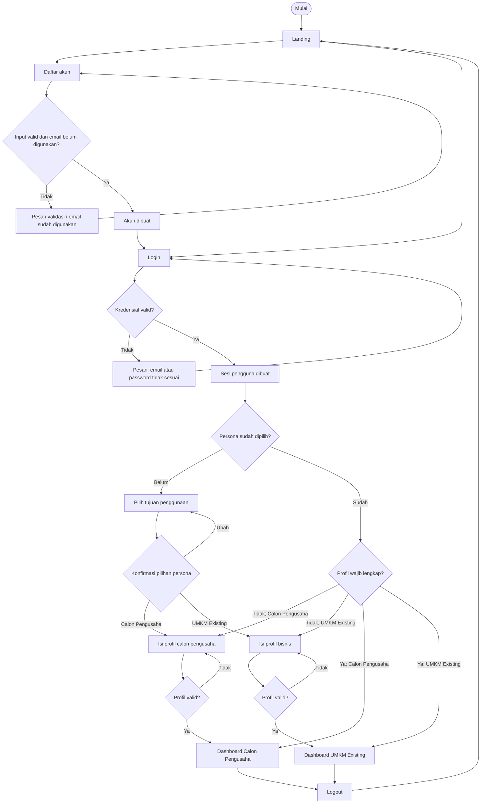
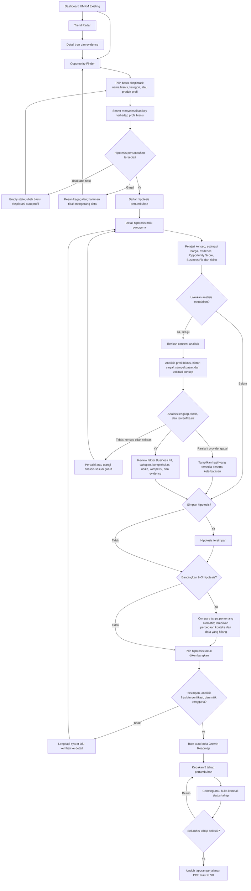
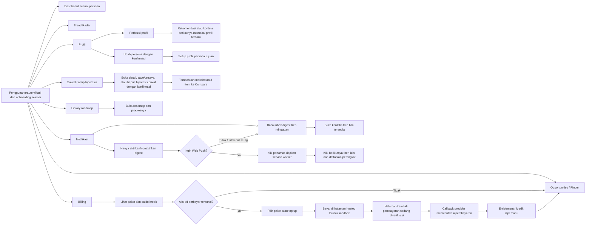

# User Flow — VENTUREX AI

Dokumen ini memetakan alur pengguna VENTUREX AI yang tersedia untuk dua persona: **Calon Pengusaha** dan **UMKM Existing**. Area dan tindakan **admin sengaja tidak dicakup**.

> Prinsip umum: seluruh halaman aplikasi memerlukan autentikasi dan onboarding lengkap. Data, skor, risiko, serta analisis adalah bantuan pengambilan keputusan—bukan jaminan keberhasilan bisnis.

## 1. Akses, autentikasi, dan onboarding

## 2. Jalur Calon Pengusaha — Discover → Analyze → Start

```mermaid
flowchart TD
    dashboard[Dashboard Calon Pengusaha] --> trends[Trend Radar]
    dashboard --> finder[Opportunity Finder]
    trends --> trendDetail[Detail tren dan evidence]
    trendDetail --> finder
    finder --> configure[Atur konteks pencarian / geografi]
    configure --> generate{Hipotesis tersedia atau dapat dibuat?}
    generate -- Tidak ada hasil --> noResults[Empty state dan ajakan ubah konteks / profil] --> configure
    generate -- Gagal --> finderError[Pesan kegagalan; data yang tersedia tetap dapat dibuka] --> finder
    generate -- Ya --> cards[Daftar hipotesis / opportunity]
    cards --> detail[Detail hipotesis milik pengguna]
    detail --> review[Pelajari konsep, target, kebutuhan, evidence, skor awal, Fit Score, dan risiko]
    review --> evidenceLimit{Evidence atau data skor cukup?}
    evidenceLimit -- Terbatas --> limited[Label keterbatasan / skor atau risiko dapat UNKNOWN] --> analysisChoice
    evidenceLimit -- Cukup --> analysisChoice{Lakukan analisis mendalam?}
    analysisChoice -- Belum --> saveChoice
    analysisChoice -- Ya, setuju --> consent[Berikan consent analisis]
    consent --> analyze[Analisis berbasis profil, histori pencarian, dan sampel pasar]
    analyze --> analysisResult{Analisis tersedia?}
    analysisResult -- Parsial / provider gagal --> partial[Gunakan hasil structured yang tersedia dan tampilkan batasan] --> saveChoice
    analysisResult -- Ya --> analysisView[Review insight, kebutuhan konsep, skor/faktor, risiko, evidence] --> saveChoice
    saveChoice{Simpan permanen?} -- Ya --> save[Hipotesis tersimpan] --> compareChoice
    saveChoice -- Tidak --> compareChoice
    compareChoice{Bandingkan 2–3 hipotesis yang dianalisis?} -- Ya --> compare[Compare: skor, cakupan, konteks, kompetisi, risiko, kebutuhan, evidence]
    compare --> selectWinner[Pilih hipotesis untuk ditindaklanjuti]
    compareChoice -- Tidak --> selectWinner
    selectWinner --> eligible{Hipotesis tersimpan, dianalisis, skor valid, dan milik pengguna?}
    eligible -- Tidak --> eligibilityHint[Perbaiki syarat: simpan / lengkapi analisis / kembali ke detail] --> detail
    eligible -- Ya --> startupRoadmap[Buat atau buka Startup Roadmap]
    startupRoadmap --> stages[Kerjakan 6 tahap validasi secara bertahap]
    stages --> stageProgress[Centang atau buka kembali status tahap]
    stageProgress --> allDone{Seluruh 6 tahap selesai?}
    allDone -- Belum --> stages
    allDone -- Ya --> report[Unduh laporan perjalanan PDF atau XLSX]
```

## 3. Jalur UMKM Existing — Discover → Analyze → Grow

## 4. Navigasi dan alur pendukung pengguna

## Aturan lintas alur

- User hanya dapat membaca atau mengubah profil, hipotesis, saved opportunity, roadmap, laporan, billing, dan notifikasi miliknya sendiri.
- Saat data jaringan dimuat, UI menyediakan state loading, sukses, kosong, dan error. Kegagalan provider/AI tidak boleh menghilangkan data structured yang masih tersedia.
- Compare memerlukan 2–3 item. Data dengan versi, cakupan, atau geografi yang berbeda tidak diberi pemenang otomatis.
- Menyimpan roadmap saja belum membuka laporan: seluruh tahap roadmap harus ditandai selesai oleh pengguna. Penyelesaian adalah deklarasi pengguna, bukan bukti keberhasilan bisnis.
- Notifikasi tidak otomatis membuat opportunity, analisis, skor, atau roadmap. Inbox tetap tersedia tanpa izin Web Push.
